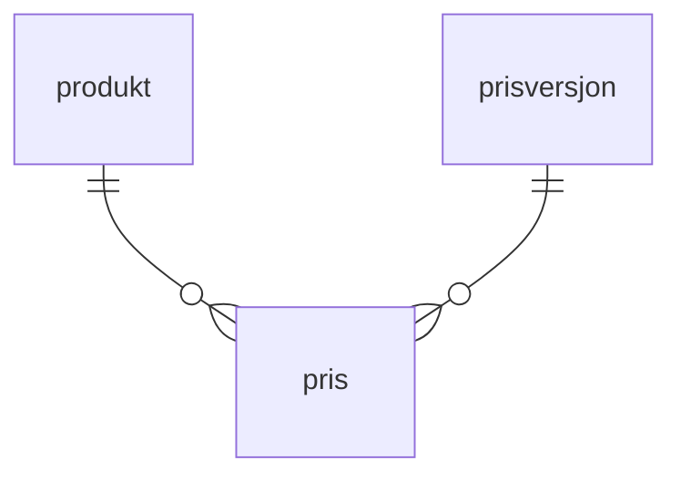
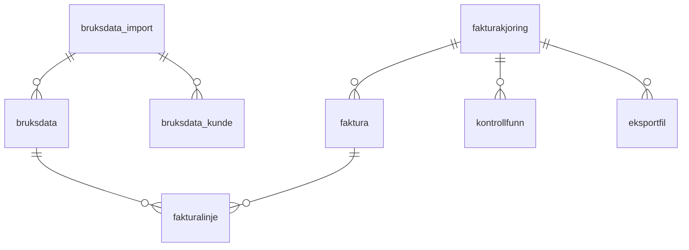

# 03 — Data model (Flyway sketch)

Authoritative starting point for the schema. The implementing agent turns these into real
Flyway migrations (`src/main/resources/db/migration/`), may refine types/indexes, but must
preserve the design decisions at the bottom of this document. Naming follows the FinMod
data-element sheet (Norwegian). Requires PostgreSQL 15+ (`unique nulls not distinct`).

## ER overview





Cross-links not drawn: `fakturalinje → produkt/pris`,
`fakturakjoring → prisversjon`, `fakturakjoring → bruksdata_import`, `bruksdata → produkt`. An
invoice identifies its customer by `organisasjonsnummer` (V17); there is no customer table.

## V1__grunnregistre.sql — products and prices

```sql
create table produkt (
    id          bigint generated always as identity primary key,
    kode        text not null unique,        -- 'melding','formidling','varsling','autorisasjon','studio','appinfra'
    navn        text not null,
    artikkel_id integer,                     -- Unit4 article; TODO(OQ-2)
    konto       text,                        -- kontering per product, not constants; TODO(OQ-2)
    dim_1       text,
    dim_2       text,
    dim_4       text,
    enhet       text not null default 'transaksjon',
    aktiv       boolean not null default true
);

create table prisversjon (
    id         bigint generated always as identity primary key,
    navn       text not null unique,         -- 'Prisliste 2027'
    gyldig_fra date not null,
    gyldig_til date,
    status     text not null default 'UTKAST'
        check (status in ('UTKAST', 'AKTIV', 'ARKIVERT'))
);

create table pris (
    id             bigint generated always as identity primary key,
    prisversjon_id bigint not null references prisversjon,
    produkt_id     bigint not null references produkt,
    enhetspris     numeric(12,4) not null,
    unique (prisversjon_id, produkt_id)
);
```

## V2__kunderegister.sql — customer registry (dropped in V18)

V2 created a local customer registry: `kunde` (orgnr, name, fakturamottaker, avtalestatus, kilde),
`kunde_referanse` (fakturareferanse/bestillingsnummer per customer, optionally per product) and
`kundenummer_regel` (Unit4 kundenummer per customer, optionally per product/servicekode, with
tilleggstekst). Økonomi decided on 2026-11-24 that forsystem keeps no customer registry: CRM is the
master and reaches forsystem through the DWH (docs/09 B-24, specs/018). Customer values now come
with each import (`bruksdata_kunde`, V17), and V18 drops the three tables. Their history is in
`hendelseslogg` (entities `KUNDE`, `KUNDE_REFERANSE`, `KUNDENUMMER_REGEL`) and in invoice snapshots.

## V3__bruksdata.sql — usage input (CSV now, DWH later, same tables)

```sql
create table bruksdata_import (
    id           bigint generated always as identity primary key,
    filnavn      text not null,
    periode      date not null check (extract(day from periode) = 1),
    kilde        text not null default 'CSV' check (kilde in ('CSV', 'DWH')),
    status       text not null default 'MOTTATT'
        check (status in ('MOTTATT', 'VALIDERT', 'AVVIST')),
    antall_rader integer,
    lastet_av    text not null,
    lastet_at    timestamptz not null default now()
);

create table bruksdata (
    id                  bigint generated always as identity primary key,
    import_id           bigint not null references bruksdata_import,
    periode             date not null check (extract(day from periode) = 1),
    organisasjonsnummer text not null,         -- the usage-generating entity
    produkt_id          bigint not null references produkt,
    type                text not null
        check (type in ('BRUKSVOLUM', 'AZURE_KOSTNAD', 'SMS_KOSTNAD')),
    antall              numeric(14,2),         -- for BRUKSVOLUM
    belop               numeric(12,2),         -- for pass-through costs
    unique (periode, organisasjonsnummer, produkt_id, type)
);
```

## V4__fakturering.sql — runs, invoices, lines, controls, exports

```sql
create table fakturakjoring (
    id             bigint generated always as identity primary key,
    periode        date not null check (extract(day from periode) = 1),
    status         text not null default 'GENERERT'
        check (status in ('GENERERT', 'GODKJENT', 'EKSPORTERT', 'FORKASTET')),
    prisversjon_id bigint not null references prisversjon,
    generert_av    text not null,
    generert_at    timestamptz not null default now(),
    godkjent_av    text,
    godkjent_at    timestamptz,
    kommentar      text
);
create unique index en_aktiv_kjoring_per_periode
    on fakturakjoring (periode) where status <> 'FORKASTET';

create table faktura (
    id                    bigint generated always as identity primary key,
    kjoring_id            bigint not null references fakturakjoring,
    kunde_id              bigint not null references kunde,  -- replaced by organisasjonsnummer (V17), dropped in V18
    faktura_uuid          uuid not null unique,   -- UUIDv7; used in PDF filenames
    ordre_nr              integer not null,       -- order_id within the LG04 file
    kundenummer           text not null,          -- snapshot at generation
    tilleggstekst         text,                   -- NULL for invoices generated after specs/018
    fakturamottaker_orgnr text not null,          -- snapshot at generation; = organisasjonsnummer since specs/018
    sum_belop             numeric(12,2) not null,
    unique (kjoring_id, kunde_id, kundenummer),   -- V17: (kjoring_id, organisasjonsnummer, kundenummer)
    unique (kjoring_id, ordre_nr)
);

create table fakturalinje (
    id                bigint generated always as identity primary key,
    faktura_id        bigint not null references faktura,
    produkt_id        bigint not null references produkt,
    beskrivelse       text not null,              -- art_desc: 'Bruk av melding januar 2027'
    antall            numeric(14,2),
    enhetspris        numeric(12,4),
    belop             numeric(12,2) not null,
    pris_id           bigint references pris,       -- traceability to the price used
    bruksdata_id      bigint references bruksdata,  -- traceability to the usage basis
    servicekode       text,                         -- NULL for lines generated after specs/018
    fakturareferanse  text,                         -- snapshot at generation
    bestillingsnummer text                          -- snapshot at generation; empty → fakturareferanse (specs/012)
);

create table kontrollfunn (
    id          bigint generated always as identity primary key,
    kjoring_id  bigint not null references fakturakjoring,
    faktura_id  bigint references faktura,
    alvorlighet text not null check (alvorlighet in ('BLOKKERENDE', 'ADVARSEL')),
    kode        text not null,      -- 'MANGLER_KUNDENUMMER','MOTSTRIDENDE_KUNDEDATA','STORT_AVVIK',...
    melding     text not null
);

create table eksportfil (
    id           bigint generated always as identity primary key,
    kjoring_id   bigint not null references fakturakjoring,
    type         text not null check (type in ('LG04', 'PDF', 'CSV', 'XLSX')),
    filnavn      text not null,
    blob_url     text not null,               -- local path in dev, blob URL in prod
    sha256       text,
    opprettet_av text not null,
    opprettet_at timestamptz not null default now()
);
```

## V5__hendelseslogg.sql — audit trail

```sql
create table hendelseslogg (
    id         bigint generated always as identity primary key,
    tidspunkt  timestamptz not null default now(),
    bruker     text not null,
    handling   text not null,       -- 'GODKJENTE_KJORING','ENDRET_PRIS','IMPORTERTE_BRUKSDATA',...
    entitet    text,
    entitet_id bigint,
    detaljer   jsonb
);
```

## V6__seed_produkter.sql

Seed the six product codes (melding, formidling, varsling, autorisasjon, studio, appinfra)
with names. `artikkel_id`, `konto`, `dim_*` stay NULL until Økonomi answers (OQ-2) — the
generation controls must treat NULL kontering as a BLOKKERENDE finding.

## V7__dwh_bruksdata.sql — usage from the datavarehus API

```sql
create table produkt_kildenavn (               -- DWH product_name -> produkt + type (OQ-18)
    id         bigint generated always as identity primary key,
    kilde      text not null default 'DWH' check (kilde in ('DWH')),
    kildenavn  text not null,                  -- exact name in the DWH view, e.g. 'Varsling e-post'
    produkt_id bigint not null references produkt,
    type       text not null check (type in ('BRUKSVOLUM', 'AZURE_KOSTNAD', 'SMS_KOSTNAD')),
    unique (kilde, kildenavn)                  -- several names may share one produkt/type (summed)
);

alter table bruksdata_import
    add column raadata_url    text,            -- archived raw DWH response (FileArchive)
    add column raadata_sha256 text,
    add column hentet_at      timestamptz,
    add constraint bruksdata_import_dwh_har_raadata
        check (kilde <> 'DWH' or (raadata_url is not null and raadata_sha256 is not null and hentet_at is not null));
```

```sql
-- V16 (specs/017): grouped source of each imported usage row; insert-only, a superseded import keeps its rows.
create table bruksdata_kilde (
    id bigint generated always as identity primary key,
    import_id bigint not null references bruksdata_import,
    organisasjonsnummer text not null,
    produkt_id bigint not null references produkt,
    type text not null check (type in ('BRUKSVOLUM', 'AZURE_KOSTNAD', 'SMS_KOSTNAD')),
    kildetabell text,                          -- DWH source_table
    ressurs text,                              -- resource_id without urn:altinn:resource:
    antall_dagsrader integer not null check (antall_dagsrader > 0),
    antall numeric,                            -- volume types
    belop numeric(14,2),                       -- cost types, øre-rounded
    regel text[] not null default '{}',        -- distinct regel texts, verbatim
    unique nulls not distinct (import_id, organisasjonsnummer, produkt_id, type, kildetabell, ressurs)
);
create index bruksdata_kilde_import_org on bruksdata_kilde (import_id, organisasjonsnummer);
```

Per (import, orgnr, produkt, type) the groups sum to the matching `bruksdata` row. Imports from files
without flags have no groups.

No seed rows for `produkt_kildenavn`: an unmapped name rejects the import. A scheduled fetch stores a
`MOTTATT` import (payload archived, no `bruksdata` rows) that a FORVALTER confirms; confirming
re-validates from the archive and moves it to `VALIDERT`.

## V8–V11 — pre-approval control basis (specs/002-pre-approval-control)

```sql
-- V8: keep superseded usage; uniqueness per import, not per period. A run records its import.
alter table bruksdata
    drop constraint bruksdata_periode_organisasjonsnummer_produkt_id_type_key,
    add constraint bruksdata_unik_per_import unique (import_id, organisasjonsnummer, produkt_id, type);
alter table fakturakjoring add column bruksdata_import_id bigint references bruksdata_import;  -- backfilled

-- V9: the stored proof that an exported LG04 matched its run (a mismatch can never be stored).
create table lg04_avstemming (
    id bigint generated always as identity primary key,
    kjoring_id bigint not null unique references fakturakjoring,
    eksportfil_id bigint not null unique references eksportfil,
    antall_ordrer_fil integer not null, sum_ore_fil bigint not null,
    antall_ordrer_kjoring integer not null, sum_ore_kjoring bigint not null,
    antall_fakturaer integer not null, sha256 text not null,
    avstemt_av text not null, avstemt_at timestamptz not null default now(),
    check (antall_ordrer_fil = antall_ordrer_kjoring and sum_ore_fil = sum_ore_kjoring)
);

-- V10: which usage rows a blocking finding kept off the invoice.
create table kontrollfunn_bruksdata (
    kontrollfunn_id bigint not null references kontrollfunn,
    bruksdata_id    bigint not null references bruksdata,
    primary key (kontrollfunn_id, bruksdata_id)
);

-- V11: customer name frozen at generation (NULL for older invoices; backfilled and NOT NULL since V17).
alter table faktura add column kundenavn text;
```

## V13 — invoice texts per run (specs/009-kjoring-fakturatekster)

```sql
-- The LG04 header (long_info1), footer (long_info2) and «Vår referanse» (responsible/responsible2),
-- stored with the run so the export writes what was approved. Defaults are set at generation.
alter table fakturakjoring
    add column topptekst text check (char_length(topptekst) <= 120),
    add column bunntekst text check (char_length(bunntekst) <= 120),
    add column var_referanse text check (char_length(var_referanse) <= 25);
-- GENERERT/GODKJENT runs are backfilled with the defaults; EKSPORTERT/FORKASTET keep NULL.
alter table fakturakjoring add constraint fakturakjoring_tekster_satt check (
    status not in ('GENERERT', 'GODKJENT')
    or (topptekst is not null and bunntekst is not null and var_referanse is not null));
```

## V14 — invoice threshold (specs/011-terskelverdi)

```sql
-- Kroner ex. mva per customer (orgnr since specs/018) per month; NULL = no threshold. Locked with the version on activation.
alter table prisversjon add column terskelverdi numeric(12,2) check (terskelverdi >= 0);
update prisversjon set terskelverdi = 40.00;

-- Would-be invoices a run left out because the customer's total was not over the threshold. No faktura
-- row exists for them; the run's UNDER_TERSKEL finding links their usage (kontrollfunn_bruksdata).
create table faktura_under_terskel (
    id bigint generated always as identity primary key,
    kjoring_id bigint not null references fakturakjoring,
    kunde_id bigint not null references kunde,  -- nullable in V17, dropped in V18
    organisasjonsnummer text not null, kundenavn text not null, kundenummer text not null,
    tilleggstekst text,
    sum_belop numeric(12,2) not null, antall_linjer integer not null check (antall_linjer >= 1),
    kundesum numeric(12,2) not null,
    terskelverdi numeric(12,2) not null check (kundesum <= terskelverdi),
    kontrollfunn_id bigint not null references kontrollfunn,
    unique (kjoring_id, kunde_id, kundenummer)  -- V17: (kjoring_id, organisasjonsnummer, kundenummer)
);
```

## V15 — accepted control findings (specs/013-kvittering-kontrollfunn)

```sql
-- A warning ticked off («Funn akseptert») before approval: current state only; every change is also
-- in hendelseslogg (AKSEPTERTE_FUNN / ANGRET_AKSEPT). Blocking findings can never be accepted.
alter table kontrollfunn
    add column akseptert_av text,
    add column akseptert_at timestamptz,
    add constraint kontrollfunn_aksept_hel check ((akseptert_av is null) = (akseptert_at is null)),
    add constraint kontrollfunn_aksept_bare_advarsel check (akseptert_at is null or alvorlighet = 'ADVARSEL');
```

## V17–V18 — customer data from the DWH, registry removed (specs/018-fjern-kunderegister)

```sql
-- V17 (additive). The customer values one import delivered for one organisation. Insert-only like
-- bruksdata and bruksdata_kilde; a superseded import keeps its rows.
create table bruksdata_kunde (
    id                  bigint generated always as identity primary key,
    import_id           bigint not null references bruksdata_import,
    organisasjonsnummer text not null,
    virksomhetsnavn     text,                    -- as delivered (the DWH sends lower case)
    kundenummer         text,                    -- NULL => MANGLER_KUNDENUMMER at generation
    fakturareferanse    text,                    -- NULL => MANGLER_FAKTURAREFERANSE (warning)
    bestillingsnummer   text,                    -- NULL => fallback to fakturareferanse (specs/012)
    motstridende        text[] not null default '{}',  -- e.g. 'kundenummer: 5663 | 5664' => MOTSTRIDENDE_KUNDEDATA
    constraint bruksdata_kunde_unik unique (import_id, organisasjonsnummer)
);
-- Backfilled for existing imports from the registry: customer default reference, kundenummer of the rule
-- without product (else the lowest rule); an orgnr without a customer gets an empty row.

alter table faktura add column organisasjonsnummer text;       -- backfilled from kunde, then NOT NULL
alter table faktura
    alter column kundenavn set not null,                         -- backfilled from kunde where NULL
    alter column kunde_id drop not null,
    add constraint faktura_unik_orgnr unique (kjoring_id, organisasjonsnummer, kundenummer);
alter table faktura_under_terskel
    alter column kunde_id drop not null,
    add constraint faktura_under_terskel_unik_orgnr unique (kjoring_id, organisasjonsnummer, kundenummer);

-- V18. Take a pg_dump of the three tables first (docs/runbook.md).
alter table faktura drop column kunde_id;
alter table faktura_under_terskel drop column kunde_id;
drop table kunde_referanse;
drop table kundenummer_regel;
drop table kunde;
```

One `bruksdata_kunde` row per organisation with at least one used usage row in the import (flagged DWH
file: flag-1 rows in the period; other formats: all valid rows), so every orgnr in an import's
`bruksdata` has exactly one row. Generation reads the rows of the run's import
(`fakturakjoring.bruksdata_import_id`; for a correction run, its kandidat import). Old runs keep
`tilleggstekst`/`servicekode` values and may have several kundenummer per orgnr, which is why
`kundenummer` stays in the new unique keys. `kontrollfunn.kode` may hold the retired codes
`MANGLER_KUNDE`, `INAKTIV_AVTALE` and `AKTIV_KUNDE_UTEN_BRUK` on old runs.

## Design decisions (preserve these)

1. **Traceability is structural**: `fakturalinje → bruksdata` (which usage),
   `fakturalinje → pris` + `fakturakjoring → prisversjon` (which price), snapshot columns
   on `faktura`/`fakturalinje` (which name/kundenummer/reference/recipient *at generation
   time* — a later import with other customer values must not rewrite history), and
   `bruksdata_kunde` per import (which customer values the DWH delivered).
2. **One invoice per organisation, customer values from the run's import** (specs/018):
   `unique (kjoring_id, organisasjonsnummer, kundenummer)`. The kundenummer, fakturareferanse,
   bestillingsnummer and name come from `bruksdata_kunde`; the fakturamottaker is the organisation
   itself. Forsystem never picks between conflicting values (MOTSTRIDENDE_KUNDEDATA blocks). Several
   kundenummer per orgnr (servicekode/tilleggstekst) and product-specific references are no longer
   supported (OQ-28); before specs/018 invoices grouped by (kunde, kundenummer) via
   `kundenummer_regel`.
3. **Run idempotency**: several runs per period allowed only if older ones are FORKASTET
   (partial unique index) — the clean version of the old system's delete-and-rerun.
4. **Usage re-import**: a new import for a period marks the previous one AVVIST (application
   logic) and **keeps its rows** — lines of a discarded run still reference them. "The period's
   usage" is the latest VALIDERT import's rows, and each run records `bruksdata_import_id`.
   (Until V8 the old rows were deleted, which failed on `fakturalinje_bruksdata_id_fkey` once any
   run existed for the period — specs/002 research R1.)
5. **`ordre_nr` lives on `faktura`, not on lines**: LG04 carries several products per order
   (OQ-1), so a faktura is normally one LG04 order. It is split into several orders only when
   its lines carry different fakturareferanse/bestillingsnummer, since the reference sits on the
   order's header line — the domain model does not change. The LG04 order number is assigned at
   export and equals `ordre_nr` unless an earlier invoice was split.
