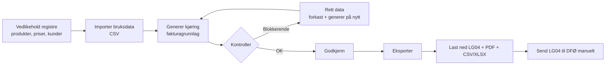
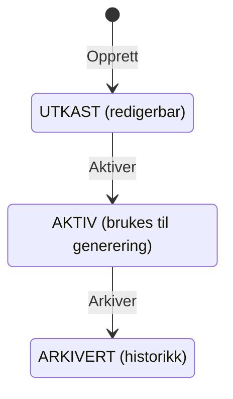
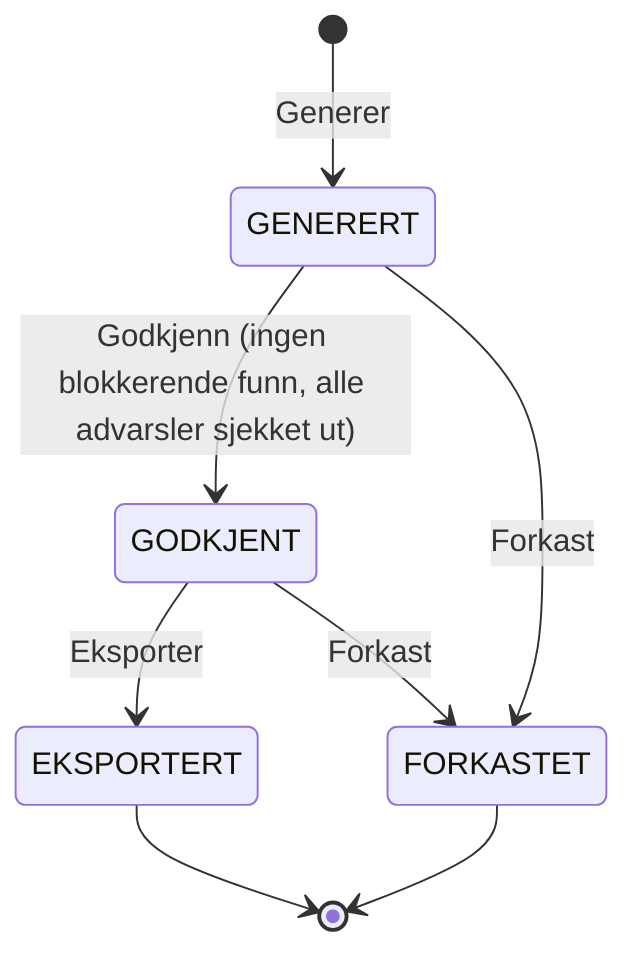
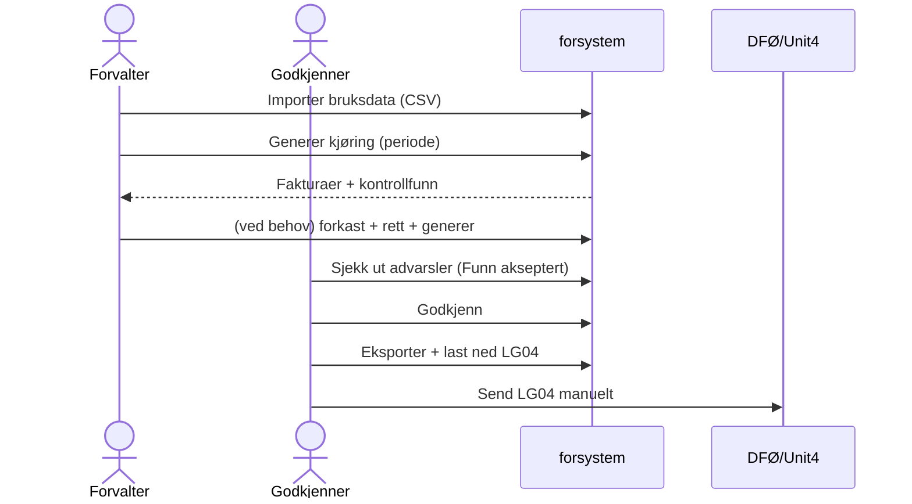

# Brukerveiledning — forsystem

Steg-for-steg innføring i forsystem: hva hver side betyr, hva hver knapp gjør, hvordan alt henger
sammen, og hvordan du kjører en faktureringsrunde fra start til slutt. Skrevet for deg som skal
bruke systemet — ingen forkunnskap om koden nødvendig.

> **Kort fortalt:** forsystem er «forsystemet» som bygger *fakturagrunnlaget* for Altinn-produktene
> under FinMod-prismodellen. Du vedlikeholder registre, importerer bruk, genererer grunnlaget, kjører
> kontroller, godkjenner, og eksporterer filene som sendes videre til Unit4 (via DFØ). Systemet lager
> ikke selve fakturaen — det lager grunnlaget.

---

## Innhold

1. [Det store bildet](#1-det-store-bildet)
2. [Roller — hvem får gjøre hva](#2-roller)
3. [Navigasjon — menyen](#3-navigasjon)
4. [Produkter](#4-produkter)
5. [Prisversjoner](#5-prisversjoner)
6. [Kunder](#6-kunder)
7. [Bruksdata (import)](#7-bruksdata)
8. [Kjøringer (generering, kontroll, godkjenning, eksport)](#8-kjøringer)
9. [Hendelseslogg](#9-hendelseslogg)
10. [Hele månedsrutinen — steg for steg](#10-månedsrutinen)
11. [Kontrollfunn — hva de betyr og hvordan du løser dem](#11-kontrollfunn)
12. [Statusflyt (diagrammer)](#12-statusflyt)
13. [Feilsøking / FAQ](#13-feilsøking)
14. [Ordliste](#14-ordliste)

---

## 1. Det store bildet

Fakturering skjer én gang i måneden, basert på faktisk bruk i **forrige** måned. Flyten gjennom
forsystem er alltid den samme:



Alt skjer **for én valgt periode** (alltid den første dagen i en måned, f.eks. `2027-01`). Perioden
velger du eksplisitt hver gang — systemet gjetter den aldri ut fra dagens dato.

---

## 2. Roller

Hva du kan gjøre avhenger av rollen din (styres av innlogging). I den lokale demoen er du logget inn
som brukeren **dev** med alle roller.

| Rolle | Kan |
|---|---|
| **LESER** | Se alt (registre, kjøringer, logg). Kan ikke endre noe. |
| **FORVALTER** | Alt LESER kan, pluss: vedlikeholde registre, importere bruksdata, generere kjøringer. |
| **GODKJENNER** | Godkjenne og eksportere kjøringer. |

> Prøver du en handling du ikke har rolle for, får du siden «Ingen tilgang». I demoen har du alt.
>
> Får du **«Siden er utløpt»**, ble skjemaet sendt fra en side som var åpen da du ble logget ut eller
> forsystem ble oppdatert. Ingenting er lagret: trykk **Last inn siden på nytt** og prøv igjen.

---

## 3. Navigasjon

Toppmenyen er lik på alle sider:

| Menyvalg | Hva det er |
|---|---|
| **forsystem** | Forsiden (dashbord med snarveier). |
| **Produkter** | De seks Altinn-produktene og kontering. |
| **Prisversjoner** | Årlige prislister, med livssyklus utkast → aktiv → arkivert. |
| **Kunder** | Tjenesteeiere, fakturareferanser og kundenummerregler. |
| **Bruksdata** | Import av bruk (CSV) per periode. |
| **Kjøringer** | Generering, kontroll, godkjenning og eksport av fakturagrunnlag. |
| **Hendelseslogg** | Sporbar logg over alle endringer. |

Rekkefølgen i menyen følger arbeidsflyten: du fyller registre (Produkter → Prisversjoner → Kunder),
importerer Bruksdata, og kjører alt under Kjøringer.

---

> **Tall og mva:** alle beløp i forsystemet er **eksl. mva** — mva legges til av regnskap. Beløp vises
> som `1 234 567,89`, antall som `1 234 567`. Enhetspriser vises med alle desimaler (f.eks. `0,0375`).

## 4. Produkter

**Hva:** de seks produktene som faktureres (`melding`, `formidling`, `varsling`, `autorisasjon`,
`studio`, `appinfra`). Disse er ferdig opprettet i systemet. Det viktigste her er **kontering** —
regnskapskodene som må stå på hvert produkt før grunnlaget kan eksporteres.

**Liste-siden (Produkter):**

| Kolonne | Betydning |
|---|---|
| Kode / Navn | Produktets id og visningsnavn. |
| Enhet | Måleenhet (standard «transaksjon»). |
| Konto / Dim1 Koststed, Dim2 Prosjekt/formål, Dim4 Kappost / Artikkel-id | Kontering (regnskap), satt per produkt og kan endres ved behov. Manglende kontering blokkerer fakturering. |
| Aktiv | Om produktet er i bruk. Inaktive produkter står nederst i lista. |

- **Rediger** (per rad) → åpner redigeringssiden.
- **Legg til** (skjema nederst): opprett et nytt produkt med kode, navn og enhet. (Normalt ikke
  nødvendig — de seks finnes fra før.)

**Rediger-siden:**

- **Navn**, **Enhet** — kan endres.
- **Kontering** (feltgruppe): Artikkel-id, Konto, Dim1, Dim2, Dim4. Dette er regnskapskodene som
  havner i LG04-fila. **La stå tomt til Økonomi bekrefter** — tomme verdier gir et blokkerende
  kontrollfunn ved generering, så du kan ikke ved et uhell fakturere med feil koder.
- **Aktiv** — avhukning.
- **Lagre** / **Avbryt**.

> **Sammenheng:** Konto/dimensjoner/artikkel-id herfra skrives inn i LG04-fila ved eksport. Uten dem
> stopper kontrollen deg (kode `MANGLER_KONTERING`).

---

## 5. Prisversjoner

**Hva:** en prisversjon er en prisliste med gyldighetsperiode (typisk ett år). Den har en livssyklus:



**Liste-siden (Prisversjoner):** viser alle versjoner med navn, gyldig fra/til og status (fargelagt
merke). **Åpne** en versjon, eller lag en ny med **Opprett** (skjemaet «Ny prisversjon (utkast)»:
navn, gyldig fra, evt. gyldig til).

> **Hva datoene betyr:** gyldig fra/til er en **teknisk regel**, ikke bare informasjon. En kjøring for
> en periode bruker den aktive versjonen som dekker **periodens første dag**. Begge datoer er
> inkludert, tom «til» betyr uten sluttdato, og to aktive versjoner kan ikke overlappe. Derfor dekker
> en versjon som starter midt i en måned (f.eks. 15. januar) først **neste** måned (februar). Siden til
> hver versjon sier i klartekst hvilke perioder den brukes for, f.eks. «Brukes for kjøringer fra januar
> 2027 og fremover».

**Detalj-siden:**

- Øverst: navn, gyldighet og status.
- **Pristabell** — én rad per **aktivt** produkt (de som må ha pris for at versjonen kan aktiveres).
  Et inaktivt produkt vises bare hvis versjonen allerede har en pris for det, og er da merket
  «inaktiv»:
  - Når versjonen er **UTKAST**: skriv inn **Enhetspris** per produkt og trykk **Lagre** på raden.
  - Når versjonen er **AKTIV/ARKIVERT**: prisene vises, men kan ikke endres (låst).
- **Aktiver** (kun i utkast): setter versjonen aktiv. Systemet sjekker først at
  - **alle aktive produkter har en pris**, og
  - **ingen annen aktiv versjon overlapper** samme datointervall.
  Er noe galt, får du en tydelig melding og aktivering stoppes.
- **Arkiver** (kun når aktiv): pensjonerer versjonen.
- **Terskelverdi** — kunder med samlet beløp for måneden **lik eller under** terskelverdien får ingen
  faktura. Beløpet summeres per kunde (organisasjonsnummer) over alle produkter og kundenumre, eksl. mva.
  En ny versjon starter på **40,00 kr**. Den kan endres mens versjonen er **UTKAST** (**Lagre
  terskelverdi**), og låses ved aktivering, som prisene. Skal terskelverdien endres for et år som
  allerede har en aktiv versjon, må det lages en ny prisversjon.

> **Sammenheng:** generering bruker den **aktive** prisversjonen som dekker den valgte perioden.
> Bruksvolum × enhetspris = beløp på fakturalinjen.

---

## 6. Kunder

**Hva:** tjenesteeierne som faktureres, med all avtaleinfo. Dette registeret er midlertidig til CRM
(Dynamics 365) eventuelt overtar. Her modellerer vi alle FinMod-spesialtilfellene.

**Liste-siden (Kunder):** virksomhet, orgnr, evt. avvikende fakturamottaker og avtalestatus.
**Ny kunde** åpner opprettingsskjemaet; **Åpne** går til detaljsiden.

**Ny kunde / Grunndata:**

| Felt | Betydning |
|---|---|
| **Organisasjonsnummer** | 9 siffer. Kundens juridiske enhet (den som genererer bruk). |
| **Virksomhetsnavn** | Navnet. |
| **Fakturamottaker orgnr** | *Valgfritt.* Fyll ut hvis en **annen** juridisk enhet skal motta fakturaen (avvikende mottaker — f.eks. Digitale Helgeland fakturert til Brønnøy kommune). |
| **Avtalestatus** | `AKTIV`, `INAKTIV` eller `UNDER_AVKLARING`. Må være AKTIV for å fakturere. |

**Detalj-siden** har tre deler:

1. **Grunndata** — rediger navn, fakturamottaker og avtalestatus. **Lagre**.
2. **Fakturareferanser** — referanser som havner på fakturalinjene.
   - Uten produkt = **standard** for kunden. En rad med produkt **overstyrer** standarden for det
     produktet (fakturareferanse kan være ulik per produkt).
   - Legg til med produkt (valgfritt), fakturareferanse og bestillingsnummer → **Legg til**. Fjern
     med **Slett**.
   - Begge feltene kan være **høyst 25 tegn** – det er plassen de har på fakturaen i Unit4.
   - **Står bestillingsnummer tomt**, får fakturaen fakturareferansen som bestillingsnummer
     («— (fakturareferansen brukes)» i tabellen). Det skjer når kjøringen genereres; registeret
     endres ikke, så retter du fakturareferansen, følger bestillingsnummeret med neste gang du
     genererer. Har kunden ulike referanser per produkt, deles fakturaen fortsatt (se `DELT_REFERANSE`).
   - Mangler **fakturareferanse** (Deres referanse), får fakturaen en advarsel
     `MANGLER_FAKTURAREFERANSE` (se kapittel 11). En produktrad uten fakturareferanse overstyrer
     standarden – produktet får da ingen fakturareferanse.
3. **Kundenummerregler** — kobler kunden til Unit4-kundenummer.
   - **Én faktura per kundenummer.** Har en kunde to kundenummer (f.eks. ulik **servicekode** per
     produkt, som Utdanningsdirektoratet), blir det to fakturaer.
   - Flere kunder kan **dele** ett kundenummer, skilt med **tilleggstekst** (f.eks.
     Politidirektoratet vs. Politi- og lensmannsetaten).
   - Legg til med kundenummer, evt. produkt, servicekode og tilleggstekst → **Legg til**. Fjern med
     **Slett**.

> **Sammenheng — dette avgjør hvordan fakturaene grupperes:** ved generering slås bruk sammen per
> (kunde, kundenummer). Regelen som passer produktet (produkt-spesifikk regel, ellers standarden)
> bestemmer hvilket kundenummer linjen havner på. Mangler en kunde med bruk en passende regel, får du
> et blokkerende funn (`MANGLER_KUNDENUMMER`).

---

## 7. Bruksdata

**Hva:** her henter eller laster du opp bruken (volum og pass-gjennom-kostnader) for en periode.
Normalt hentes den fra datavarehuset; CSV-opplasting er reserveløsningen.

**Liste-siden (Bruksdata):**

- **Hent fra datavarehus** (vises når integrasjonen er slått på): velg **Periode** og trykk knappen.
  Datavarehuset leverer bruk per dag; forsystemet summerer til én rad per organisasjon, produkt og type
  og viser samme forhåndsvisning som for CSV. Produktnavn fra datavarehuset må være koblet til et
  produkt under **Produkter → Kildenavn** — et ukjent navn avviser importen.
- **Last opp fil**: velg **Periode** (måned) og **Fil**, trykk **Forhåndsvis**. Fila kan være forsystemets
  eget CSV-format eller datavarehusets egen eksport (`mv_altinn_usage_monthly`); formatet gjenkjennes
  automatisk, og forhåndsvisningen sier hvilket det ble. Last opp fila slik du fikk den, uten å åpne og
  lagre den i Excel først (Excel lagrer med semikolon, og da kjennes den ikke igjen). Kjenner forsystemet
  ikke igjen fila, viser feilmeldingen hvilke kolonner fila har og hvilke som var forventet.
- **Eksport fra datavarehuset** (når API-et ikke kan brukes): kontrolleres akkurat som en henting fra
  datavarehuset (produktnavn kobles under **Kildenavn**). I forhåndsvisningen ser du hvor mange organisasjoner i fila
  som ikke er kunder ennå; **Opprett kunder fra fila** registrerer dem med navn, kundenummer og
  fakturareferanse slik datavarehuset har dem, og avtalestatus AKTIV. Deretter **Bekreft import**.
- Tabell over tidligere importer med status. En import med status **MOTTATT** er hentet automatisk og
  venter på at du åpner den og trykker **Bekreft import**.

**Datavarehus-importer** viser når dataene ble hentet, sjekksum (SHA-256) og en lenke for å laste ned
nøyaktig det datavarehuset leverte. **Advarsler** i forhåndsvisningen (f.eks. at datavarehuset har et
annet kundenummer enn kunderegisteret, eller at et produkt har endret seg mye fra forrige måned)
hindrer ikke import, men bør sjekkes.

**CSV-formatet** (detaljer i [csv-format.md](csv-format.md)): kolonner `periode, organisasjonsnummer,
produktkode, type, antall, belop`. `type` er `BRUKSVOLUM` (bruk `antall`), `AZURE_KOSTNAD` eller
`SMS_KOSTNAD` (bruk `belop`). Eksempel:

```csv
periode,organisasjonsnummer,produktkode,type,antall,belop
2027-01-01,958935420,melding,BRUKSVOLUM,15000,
2027-01-01,958935420,varsling,SMS_KOSTNAD,,1250.50
```

**Forhåndsvisning (før noe lagres):**

- **Summer per produkt** — produktnavn, antall rader og summer, så du kan sammenligne med fila.
- **Avviste rader** — hver feil med linjenummer og årsak (ukjent produkt, feil orgnr, feil periode,
  duplikat, negativ verdi …).
- **Alt-eller-ingenting:** har fila **én** avvist rad, kan den ikke importeres — rett fila og last opp
  på nytt. Ingenting lagres før alt er gyldig.
- **Bekreft import** (vises bare når alt er OK) lagrer bruken. **En bekreftet import kan ikke slettes
  eller endres** — siden minner om det rett over knappen. **Avbryt** forkaster forhåndsvisningen.
- Når bruken er importert, er neste steg **Kjøringer** (lenke nederst på Bruksdata-siden).

**Re-import:** laster du opp samme periode på nytt, **erstattes** perioden — de gamle radene slettes og
den forrige importen merkes `AVVIST`.

> **Sperre:** finnes det allerede en kjøring for perioden som ikke er forkastet, blokkeres import (du
> må forkaste kjøringen først). Da unngår du å endre bruk en kjøring allerede bygger på.

---

## 8. Kjøringer

Her skjer selve faktureringen. En **kjøring** (fakturakjøring) er én runde for én periode.



**Liste-siden (Kjøringer):**

- **Ny kjøring**-skjema: velg **Periode**, trykk **Generer**. Systemet henter bruksdata for perioden
  og den aktive prisversjonen, bygger fakturaene, og kjører kontrollene.
- Tabell over kjøringer med status. **Åpne** for detaljer.
- *Kun én aktiv kjøring per periode:* vil du kjøre på nytt, må du først **forkaste** den gamle.
- **Testverktøy: nullstill periode** (bare i testmiljøet tt02 og lokalt): sletter alle kjøringer for
  en måned for godt, også eksporterte, med fakturaer, kontrollfunn, eksportfiler og alle
  bruksdataimporter. Kunder, produkter, priser og hendelsesloggen beholdes. Etterpå kan du laste opp
  samme fil og kjøre måneden helt gjennom igjen. Finnes ikke i produksjon.

**Detalj-siden:**

- **Status** øverst (fargelagt merke).
- **Tekster på fakturaen** — tre tekster som står på hver faktura i Unit4, ferdig utfylt når kjøringen
  genereres:

  | Felt | Standardtekst | Maks i LG04-fila | Trykt faktura (regnskaps mal) |
  |---|---|---|---|
  | **Topptekst** (over linjene) | «Bruk av Altinn januar 2027» (kjøringens måned) | 120 tegn | 90 tegn |
  | **Bunntekst** (under linjene) | «Se samarbeid.digdir.no for priser og innsyn i egen statistikk» | 120 tegn | 65 tegn |
  | **Vår referanse** (kontaktpunkt) | `Servicedesk@altinn.no` | 25 tegn | — |

  Mens kjøringen er **GENERERT** kan FORVALTER endre tekstene og trykke **Lagre tekstene**. Tekst over
  LG04-grensen, med linjeskift eller med tegn LG04-fila ikke kan lagre (f.eks. emoji), avvises med en
  melding, og det du skrev står igjen i skjemaet. Går teksten over regnskaps grense for trykt faktura,
  lagres den, men siden advarer: FEL har ikke bekreftet hvilken grense som gjelder (OQ-23). Lenker i
  bunnteksten er ikke klikkbare i fakturaen. Hver endring havner i **Historikk** med gammel og ny
  tekst. Fra **Godkjenn** av er tekstene låst — vil du endre dem etter godkjenning, må kjøringen
  forkastes og genereres på nytt (da starter tekstene fra standard igjen). Kjøringer eksportert før
  funksjonen kom, viser «Tekstene ble ikke lagret for denne kjøringen».
- **Sammendrag** — antall fakturaer, antall LG04-ordrer (én ordre per faktura, OQ-1),
  antall linjer, sum beløp eksl. mva og sum inkl. mva. Mva er 25 % og regnes per faktura (summen × 1,25,
  avrundet til øre), slik regnskap får det i Unit4-rapporten. Det kan likevel avvike med noen øre.
- **Til e-post til regnskap** (når kjøringen er GODKJENT eller EKSPORTERT) — område (Altinn),
  buntnummer (datoen LG04-fila ble laget), periode, antall fakturaer og samlet beløp eksl. og inkl. mva,
  klare til å kopieres inn i følge-e-posten med **Kopier**.
- **LG04-avstemming** (når kjøringen er EKSPORTERT) — viser at LG04-fila har nøyaktig like mange
  ordrer og samme beløp som kjøringen («LG04 stemmer med fakturagrunnlaget»). **Kontroller arkivert
  LG04 på nytt** leser den lagrede fila på nytt og sjekker at den ikke er endret.
- **Avstemming bruksdata** — se under. Tabellen *Per produkt og type* og listen *Ikke fakturert* kan
  lastes ned som XLSX/CSV rett under hver tabell på fanen *Kontroller*.
- **Fakturaer uten fakturareferanse** (fanen *Kontroller*, under kontrollfunnene) — fakturaene som har
  linjer uten «Deres referanse», med nedlasting som XLSX/CSV. Se kapittel 11.
- **Last ned fakturagrunnlag (XLSX, for Excel)** / **(CSV)** — alle fakturalinjene i et regneark, også
  *før* godkjenning. Filnavnet inneholder status (f.eks. `fakturagrunnlag-2027-01-GENERERT.xlsx`), så et
  utkast ikke forveksles med det godkjente grunnlaget. Nedlastingen endrer ingenting, men logges.
  Beløp, antall og enhetspris er tall i Excel, så du kan summere dem.
- **Blokkerende kontrollfunn** (rød) — må løses før godkjenning.
- **Advarsler** (gul) — trenger ikke rettes, men må **sjekkes ut** (kryss av «Funn akseptert» på fanen
  *Kontroller*) før kjøringen kan godkjennes. Se kapittel 11.
- **Fakturaer** — én rad per faktura:

  | Kolonne | Betydning |
  |---|---|
  | Ordre | Løpenummer i kjøringen (ordre-id i LG04). |
  | Kunde | Kundens navn slik det var da kjøringen ble generert. «(nåværende navn)» betyr at fakturaen er eldre enn denne funksjonen, og navnet er hentet fra kunderegisteret i dag. |
  | Kundenummer | Unit4-kundenummer fakturaen gjelder. |
  | Tilleggstekst | Skiller delte kundenummer. |
  | Mottaker (orgnr) | Hvem som mottar (avvikende mottaker hvis satt, ellers kundens orgnr). |
  | Sum | Sum av linjene. |
  | **Linjer** | Åpner faktura­detaljene (drill-down): kundenavn, referanse, linjene og en sumrad nederst. |

  **Last ned fakturalisten (XLSX/CSV)** gir samme liste som regneark, én rad per faktura.
- **Faktureres ikke (under terskelverdi)** — under fakturalisten på fanen *Fakturaer*: kundene som
  ikke får faktura fordi samlet beløp for måneden er lik eller under terskelverdien i prisversjonen,
  med kundenummer, beløp og kundens samlede sum. Listen kan lastes ned som XLSX/CSV. Beløpene faller
  bort og overføres ikke til neste måned. Korrigeringskjøringer har ingen terskel.

- **Handlinger:**
  - Når **GENERERT**: **Godkjenn** (deaktivert hvis det finnes blokkerende funn eller advarsler som ikke
    er sjekket ut) og **Forkast**.
  - Når **GODKJENT**: **Eksporter** og **Forkast**.
- **Eksportfiler** (etter eksport): tabell med type, filnavn, SHA-256 og **Last ned**.

**Avstemming bruksdata:** kontrollerer at alle bruksdata har kommet med på fakturagrunnlaget — den
ser ikke på prisliste eller kostnad. Den sammenligner bruksdataene kjøringen ble bygget fra (importerte
rader og importert bruksdata fra datavarehus) med det som ble fakturert (fakturerte linjer og fakturert
bruksdata), per produkt og type (volum sammenlignes på antall, Azure/SMS-kostnader på beløp). Under
tabellen står hver bruksdatarad som *ikke* ble fakturert, med årsaken — kontrollfunnet som stoppet
den (f.eks. `MANGLER_KUNDE`). Står det «All bruksdata er med i fakturagrunnlaget», er ingenting
utelatt. Aktive produkter uten bruk i perioden vises med 0, så et manglende produkt synes. Siden viser
bare bruk som kom inn i forsystemet — bruk som datavarehuset filtrerer bort før det når oss, er ikke
med.

**Eksport stoppet:** Før noe lagres, leser forsystemet LG04-fila tilbake og sammenligner den med
kjøringen. Stemmer den ikke, stoppes eksporten: ingen filer lages, kjøringen er fortsatt GODKJENT, og
du får en rød melding med tallene. Dette er alltid en feil i forsystemet, ikke i dataene dine —
kontakt forsystem-teamet, og trykk **Eksporter** på nytt når feilen er rettet. Ingenting må gjøres om.

**Faktura-detalj (Linjer):** viser hver fakturalinje med produkt, beskrivelse (f.eks. «Bruk av melding
januar 2027»), servicekode, referanse, antall, enhetspris, beløp, og **sporbarhet** tilbake til
bruksdata-id og pris-id. Kontrollfunn knyttet til fakturaen vises øverst.

**Eksport** produserer og arkiverer fire filer (med SHA-256):

| Fil | Hva | Bruk |
|---|---|---|
| **LG04** | Fast-bredde tekstfil (Windows-1252) | Importeres i Unit4 via DFØ. |
| **PDF** (zip) | Én detaljvisning per faktura, `<kundenummer>-<uuid>.pdf` | Til tjenesteeierne. |
| **CSV** | Alle linjer, kommaseparert | Maskinell kontroll. |
| **XLSX** | Alle linjer, Excel (samme kolonner som nedlastingen før godkjenning) | Analyse / kontroll. |

> **Nedlasting:** trykk **Last ned** på filen du vil ha. Fila lastes ned til maskinen din. LG04-fila
> er allerede Windows-1252-kodet — **ingen `iconv`** trengs. Send den til DFØ via avtalt kanal.

---

## 9. Hendelseslogg

En skrivebeskyttet, tidssortert logg over alle endringer: hvem gjorde hva, når, på hvilken entitet, med
detaljer. Hver registerendring, import, generering, godkjenning og eksport havner her automatisk, og
hver nedlasting av eksportfiler og fakturagrunnlag (`LASTET_NED`, med filtype). Bruk den til å svare på
«hva skjedde med denne kjøringen / kunden?» og «er LG04-fila allerede hentet?».

Hele loggen er tilgjengelig, 50 hendelser per side med de nyeste først (**Forrige** / **Neste**).
Tidspunktene er norsk tid, og detaljene vises som «nøkkel: verdi», f.eks.
`periode: 2027-01; antallFakturaer: 7`.

**Filtrer:** velg **Fra dato** og/eller **Til dato** (begge dagene er med), skriv en del av et
**brukernavn** (store og små bokstaver er likegyldige), og velg **Entitet** og/eller **Handling** fra
listene. Trykk **Filtrer**. Filtrene gjelder samtidig, og de står i adressen, så du kan dele en filtrert
visning. **Nullstill filter** viser alt igjen.

**Last ned:** **Last ned hele loggen (XLSX)** gir alle hendelsene i et regneark, **Last ned utvalget
(XLSX)** bare dem som passer filteret (alle sider). **CSV** gir det samme som tekstfil. Regnearket har
kolonnene tidspunkt (dato og klokkeslett i Excel, norsk tid), bruker, handling, entitet, entitet_id,
periode (hentet fra detaljene når hendelsen gjelder en måned), detaljer (lesbar tekst) og detaljer_json
(slik det er lagret). Overskriftsraden har filterpiler og blir stående når du blar. Nedlastingen logges
selv (`LASTET_NED`, entitet `HENDELSESLOGG`).

---

## 10. Månedsrutinen

Den komplette rutinen for å fakturere forrige måned (roller i parentes):

1. **Sjekk registrene** (FORVALTER):
   - Årets prisversjon er **AKTIV** og dekker perioden.
   - Alle produkter som skal faktureres har **kontering** (ellers stopper kontrollen deg).
   - Kunder, referanser og kundenummerregler er oppdatert.
2. **Importer bruk** (FORVALTER): *Bruksdata* → velg periode, last opp fila, sjekk forhåndsvisningen,
   **Bekreft import**.
3. **Generer** (FORVALTER): *Kjøringer* → velg periode → **Generer**. Åpne kjøringen og gå gjennom
   sammendrag, fakturaer og funn. Kontroller med **Avstemming bruksdata** og **Last ned
   fakturagrunnlag (XLSX)**.
   Sjekk **Tekster på fakturaen** (topptekst, bunntekst, Vår referanse) og endre dem om Økonomi vil
   ha noe annet denne måneden — de låses ved godkjenning.
4. **Løs blokkerende funn** hvis noen: rett dataene, **Forkast** kjøringen, og **Generer** på nytt.
5. **Sjekk ut advarslene** (FORVALTER eller GODKJENNER): på fanen *Kontroller*, se på hver advarsel og
   kryss av **Funn akseptert**. Oversikten sier da «N advarsler, gjennomgått og sjekket ut. Hindrer ikke
   godkjenning».
6. **Godkjenn** (GODKJENNER): **Godkjenn** når det ikke er blokkerende funn og alle advarsler er sjekket ut.
7. **Eksporter** (GODKJENNER): **Eksporter**. Sjekk at **LG04-avstemming** sier at fila stemmer, og
   **Last ned** LG04 + PDF-zip + CSV/XLSX.
8. **Send til DFØ** (manuelt): send LG04-fila videre med tallene fra **Til e-post til regnskap**;
   distribuer PDF-ene til tjenesteeierne.



---

## 11. Kontrollfunn

Kontrollene kjøres automatisk ved generering. **Blokkerende** funn hindrer godkjenning til de er rettet;
**advarsler** trenger ikke rettes, men hindrer godkjenning til noen har sjekket dem ut (se *Sjekke ut
advarsler* nedenfor). På fanen **Kontroller** forklarer «Hva betyr alvorlighet?» og «Hva betyr
kodene?» (også lenket fra kolonneoverskriftene) hver kode kort; kolonnen **Beskrivelse** viser et
eksempel på meldingen.

| Kode | Alvor | Betyr | Slik løser du det |
|---|---|---|---|
| `MANGLER_KUNDE` | Blokkerende | Bruk for et orgnr uten registrert kunde. | Opprett kunden, eller rett orgnr i bruksdata. |
| `MANGLER_KUNDENUMMER` | Blokkerende | Kunden mangler en kundenummerregel som passer produktet. | Legg til en kundenummerregel på kunden. |
| `INAKTIV_AVTALE` | Blokkerende | Kunden har avtalestatus ≠ AKTIV. | Sett avtalestatus AKTIV (når avtalen er avklart). |
| `MANGLER_PRIS` | Blokkerende | Produktet har ingen pris i den aktive versjonen. | Legg inn pris i prisversjonen. |
| `MANGLER_KONTERING` | Blokkerende | Produktet mangler konto/dimensjoner. | Fyll inn kontering på produktet (når Økonomi har levert kodene). |
| `STORT_AVVIK` | Advarsel | Kundens sum avviker > 30 % fra forrige periode. | Sjekk at bruken stemmer. |
| `NULLBELOP` | Advarsel | Fakturaen har en linje med beløp 0. | Vurder om linjen skal være med. |
| `NY_KUNDE` | Advarsel | Kunden ble ikke fakturert forrige periode. | Bekreft at ny kunde er forventet. |
| `AKTIV_KUNDE_UTEN_BRUK` | Advarsel | Kunden har aktiv avtale, men ingen bruk i perioden. En forventet tjenesteeier kan mangle i grunnlaget. | Sjekk om fraværet er riktig (ingen fakturerbar bruk), eller om bruken mangler i datavarehuset. |
| `UNDER_TERSKEL` | Advarsel | Én eller flere kunder har samlet beløp for måneden lik eller under terskelverdien og faktureres ikke. Meldingen viser antall kunder, samlet beløp og terskelverdien. | Se listen *Faktureres ikke (under terskelverdi)* under Fakturaer. Bruken deres vises som «ikke fakturert» i Avstemming bruksdata med denne koden som årsak. |
| `MANGLER_FAKTURAREFERANSE` | Advarsel | Minst én linje på fakturaen har ingen fakturareferanse (Deres referanse). Én advarsel per faktura, med kunde, orgnr, kundenummer og produktene som mangler. Kunden kan avvise en faktura uten referanse. | Se listen **Fakturaer uten fakturareferanse** under kontrollfunnene (kan lastes ned som XLSX/CSV). Legg inn referansen på kunden under **Kunder**, forkast og generer på nytt. |
| `DELT_REFERANSE` | Advarsel | Linjene på fakturaen har ulik fakturareferanse/bestillingsnummer. LG04 kan bare ha én referanse per ordre, så kunden får én faktura i Unit4 per referanse. | Sjekk at det er ønsket. Skal kunden ha én faktura, fjern den produktspesifikke referansen i kunderegisteret og generer på nytt. |

**Fakturaer uten fakturareferanse:** under kontrollfunnene på fanen **Kontroller** står fakturaene i
kjøringen som har linjer uten fakturareferanse: kunde, orgnr, kundenummer, hvilke produkter som mangler
referanse («Alle» når ingen linjer har den), sum og en lenke til linjene. **Last ned listen (XLSX)** /
**CSV** gir samme liste i et regneark. Kunder som ikke faktureres denne måneden (under terskelverdi eller
uten bruk) er ikke med.

**Sjekke ut advarsler («Funn akseptert»):** når du har sett på en advarsel og den er i orden, kryss av
**Funn akseptert** i kolonnen til høyre på fanen **Kontroller**. FORVALTER og GODKJENNER kan krysse av;
LESER kan ikke.

- Én advarsel: kryss av på raden. Under avkrysningen står hvem som krysset av, og når.
- Flere advarsler med samme kode: **Funn akseptert (alle N)** på raden sjekker ut alle på én gang. Under
  **Vis alle …** kan du i stedet krysse av hver for seg; raden viser da «N av M akseptert».
- Fjerner du krysset, er advarselen åpen igjen.
- En sjekket ut advarsel teller ikke lenger på tallet ved fanen *Kontroller* og i listen over kjøringer.
  Oversikten viser «N advarsler, gjennomgått og sjekket ut. Hindrer ikke godkjenning».
- **Godkjenn** er grå til alle advarsler er sjekket ut.
- Blokkerende funn kan ikke sjekkes ut. De må rettes: forkast, rett dataene og generer på nytt.
- Hver avkrysning og hvert fjernet kryss står i kjøringens **Historikk** (`AKSEPTERTE_FUNN` /
  `ANGRET_AKSEPT`) med bruker, tidspunkt og hvilke funn.
- Avkrysningene låses når kjøringen godkjennes. En kjøring som genereres på nytt, starter uten avkrysninger.
  Det samme gjelder korrigeringskjøringer.

**Last ned listene:** under kontrollfunnene gir **Last ned kontrollfunn (XLSX)** / **CSV** alle funnene,
én rad per funn, med alvorlighet, kode, beskrivelse, faktura (ordre, kundenummer, kundenavn) og om funnet
er akseptert, av hvem og når. Avstemming bruksdata og Ikke fakturert har egne nedlastinger under tabellene.
Nedlastingene logges i Historikk. PDF får du med nettleserens **Skriv ut → Lagre som PDF**: siden skrives
ut uten menyer og knapper.

**Etter å ha rettet:** forkast kjøringen, rett dataene, og generer på nytt. Funnene beregnes på nytt, og
ingen advarsler er sjekket ut i den nye kjøringen.

---

## 12. Statusflyt

Samlet oversikt over statusene i systemet:

| Entitet | Statuser | Overganger |
|---|---|---|
| Prisversjon | UTKAST → AKTIV → ARKIVERT | Aktiver / Arkiver |
| Bruksdata-import | MOTTATT / VALIDERT / AVVIST | Bekreft (VALIDERT) · re-import merker gammel AVVIST |
| Kjøring | GENERERT → GODKJENT → EKSPORTERT · FORKASTET | Generer / Godkjenn / Eksporter / Forkast |
| Avtalestatus (kunde) | AKTIV / INAKTIV / UNDER_AVKLARING | Settes manuelt |

---

## 13. Feilsøking

| Symptom | Årsak / løsning |
|---|---|
| **Kan ikke godkjenne** (knappen er grå) | Kjøringen har blokkerende funn, eller advarsler som ikke er sjekket ut. Blokkerende: løs dem (se §11), forkast + generer på nytt. Advarsler: kryss av «Funn akseptert» på fanen *Kontroller*. |
| **«Ingen aktiv prisversjon dekker perioden»** | Aktiver en prisversjon som dekker perioden (§5). |
| **«Ingen bruksdata for perioden»** | Importer bruk for perioden først (§7). |
| **Import blokkeres** | Det finnes en ikke-forkastet kjøring for perioden. Forkast den, importer på nytt. |
| **CSV avvist** | Se avviste rader med linjenummer i forhåndsvisningen; rett og last opp på nytt. |
| **Generering blokkeres av «aktiv kjøring finnes»** | Forkast den eksisterende kjøringen for perioden først. |
| **Eksportert kjøring kan ikke forkastes** | Med vilje — korreksjoner håndteres av en fremtidig avregningsmekanisme. I testmiljøet kan du i stedet bruke **Nullstill periode** nederst på Kjøringer-siden. |

---

## 14. Ordliste

| Term | Betyr |
|---|---|
| Fakturagrunnlag | De beregnede linjene bak en faktura (det forsystem lager). |
| Fakturakjøring / kjøring | En faktureringsrunde for én periode. |
| Tjenesteeier | Kunden som faktureres. |
| Periode | Faktureringsmåned, alltid den 1. i måneden (`ÅÅÅÅ-MM`). |
| Kontering | Regnskapskoder (konto, dimensjoner, artikkel-id) per produkt. |
| Prisversjon | Versjonert prisliste med gyldighetsperiode. |
| Bruksvolum | Antall (transaksjoner) per orgnr/produkt/periode. |
| Kundenummer | Kunde-id i Unit4. Én faktura per kundenummer. |
| Servicekode / tilleggstekst | Attributter som gir flere/delte kundenummer. |
| LG04 | Fast-bredde importformat for Unit4 (via DFØ). |
| Kontrollfunn | Resultat av en automatisk kontroll (blokkerende eller advarsel). |
| Avregning | Fremtidig mekanisme for korreksjoner/kreditering (ikke bygget ennå). |

---

*Vil du prøve alt selv?* Den lokale demoen (`docker compose up`) er ferdig fylt med realistiske
testdata — se [runbook.md](runbook.md) for en komplett gjennomgang.
